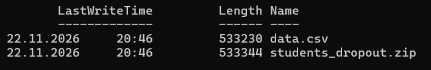
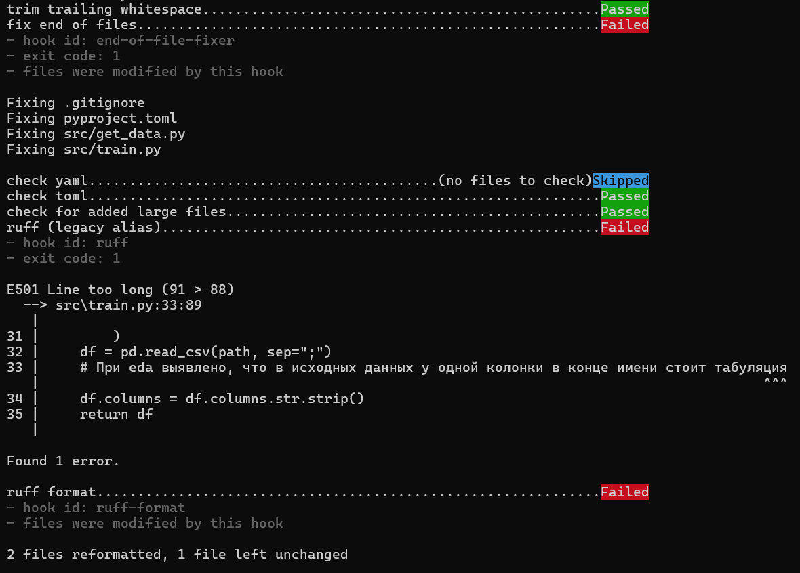
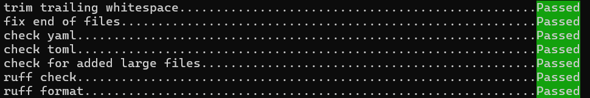
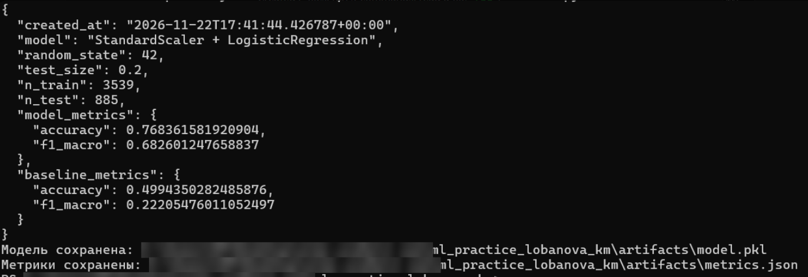

# ДЗ 1. Воспроизводимый ML-проект — отчёт

Датасет: [Predict Students' Dropout and Academic Success](https://archive.ics.uci.edu/dataset/697/predict+students+dropout+and+academic+success)
(UCI, CC BY 4.0). Задача: многоклассовая классификация исхода обучения
студента (`Dropout` / `Enrolled` / `Graduate`).

Все команды запускались из корня проекта в PowerShell (Windows 11, uv 0.13,
Python 3.13). Ниже приведён реальный вывод команд.

## 1. Загрузка данных

```powershell
uv run python -m src.get_data
```


Скрипт скачивает архив с UCI, распаковывает `data.csv` в `data/raw/` и
проверяет его: файл существует и не пустой, размер 4424 × 37, есть колонка
`Target` ровно с классами `Dropout`, `Enrolled`, `Graduate`. Если проверка не
прошла, скрипт падает с `ValueError`. Токен не нужен.

Содержимое `data/raw/` после запуска:



## 2. Проверка кода: Ruff и pre-commit

Правила Ruff в `pyproject.toml`: `E`, `F`, `W`, `I`, `B`, `UP`, длина строки 88.
Хуки в `.pre-commit-config.yaml`: `trailing-whitespace`, `end-of-file-fixer`,
`check-yaml`, `check-toml`, `check-added-large-files`, `ruff-check --fix`,
`ruff-format`.

### 2.1. Первый запуск. Были найдены нарушения



Что было найдено и как исправлено:

| Нарушение | Исправление |
|---|---|
| нет перевода строки в конце 4 файлов | автоматически, `end-of-file-fixer` |
| `E501`: слишком длинный комментарий в `src/train.py:33` | вручную, комментарий сокращён |
| форматирование `src/get_data.py`, `src/train.py` | автоматически, `ruff format` |
| устаревший id хука `ruff` | вручную, заменён на `ruff-check` |
| `check yaml` пропущен | `.pre-commit-config.yaml` ещё не был добавлен в Git; после `git add` проверяется |

### 2.2. Повторный запуск. В нем все проверки пройдены



## 3. Обучение

```powershell
uv run python -m src.train
```

